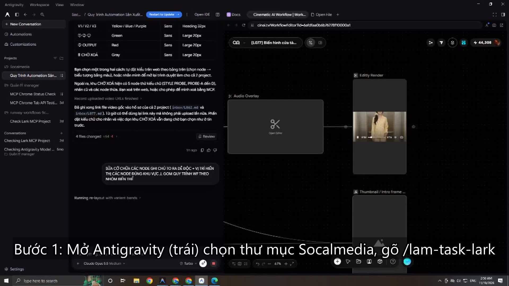
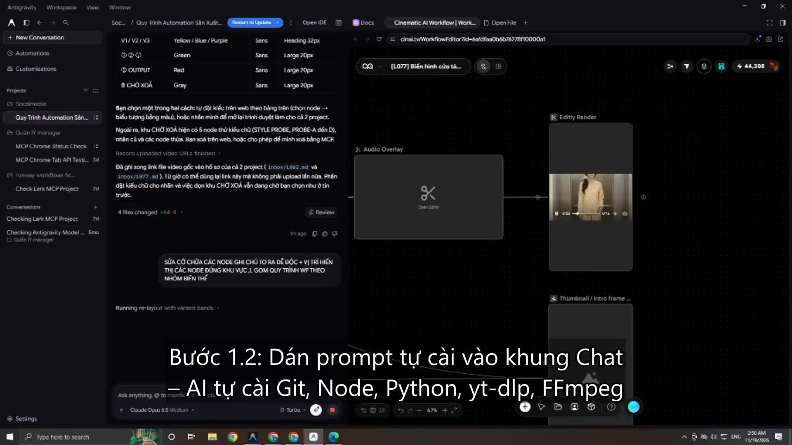
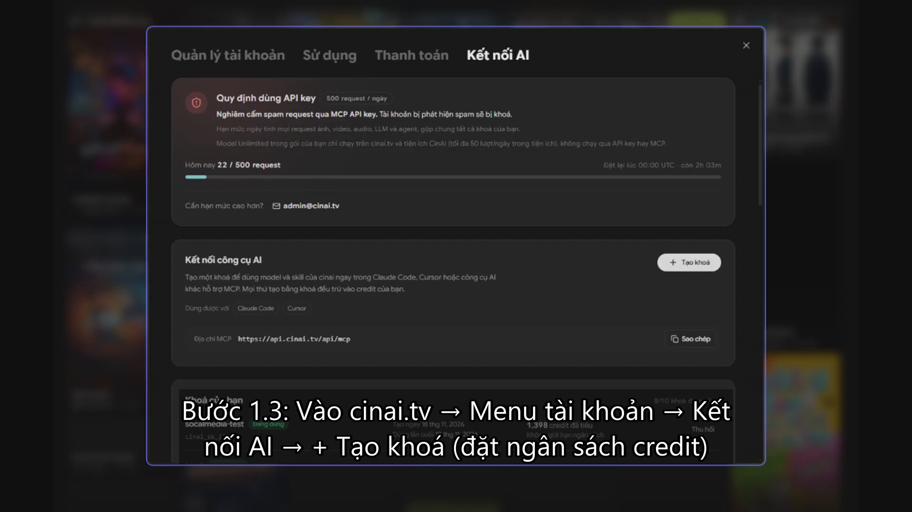
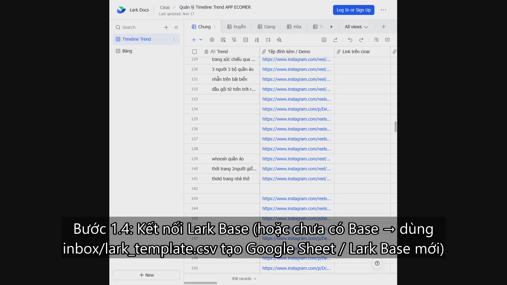
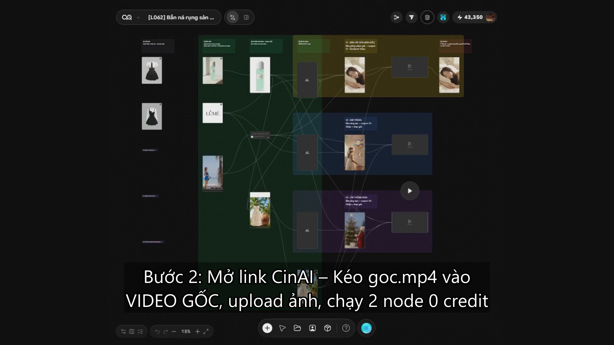
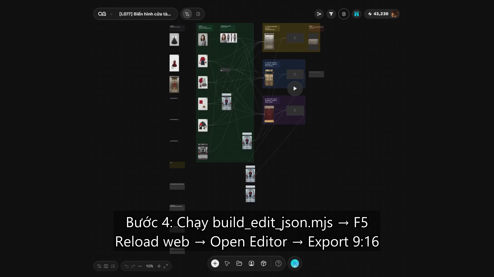
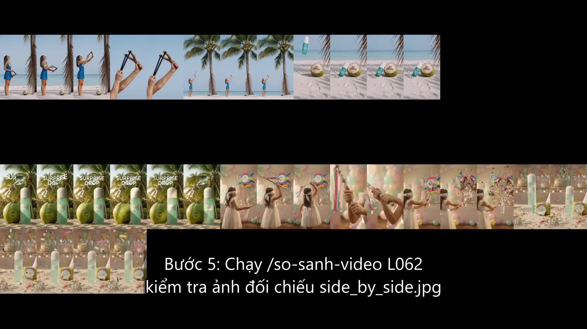
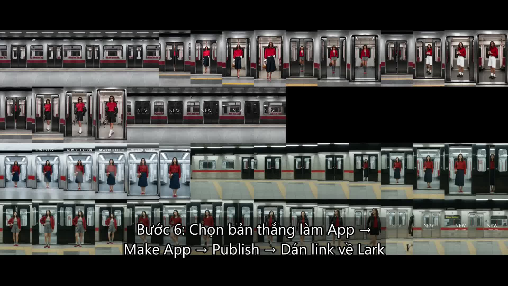
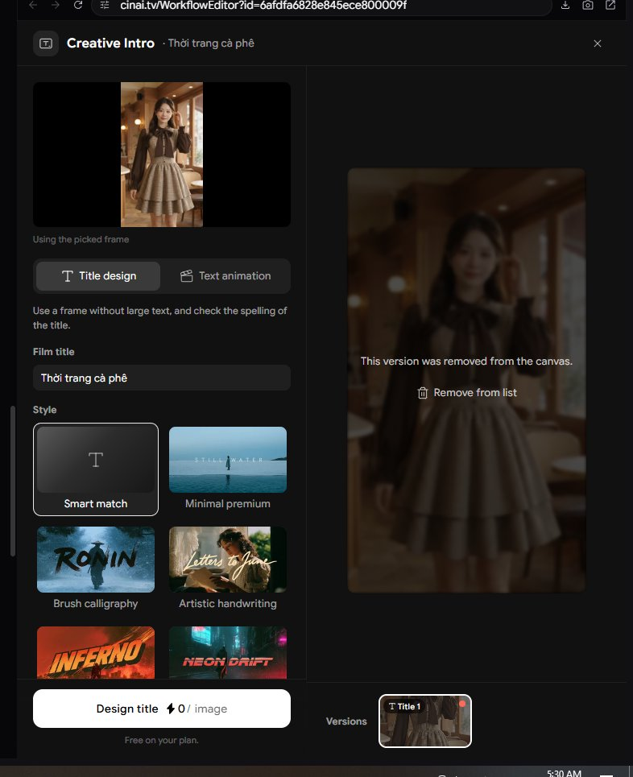

# HƯỚNG DẪN NHÂN VIÊN (DÀNH CHO NGƯỜI MỚI BẮT ĐẦU)
**Bộ skill "Omni Gemini 1.2 Automation WF" trên Antigravity + CinAI.tv**

> **Tóm tắt 1 câu:** Bạn chỉ cần đưa link video trend trên Lark → mở **Antigravity**, gõ 1 câu yêu cầu → AI tự xem video và dựng sẵn **3 phiên bản workflow (V1 giống gốc + V2, V3 sáng tạo)** trên `cinai.tv` → bạn upload ảnh, bấm chạy, kiểm tra ảnh đối chiếu rồi bấm **Make App → Publish**.

---

## 🎥 VIDEO & HÌNH ẢNH XEM NHANH TRƯỚC KHI LÀM

- **Video tổng quan màn hình thực tế (30 giây):** [huong-dan-img/huong-dan-tu-dau.mp4](huong-dan-img/huong-dan-tu-dau.mp4)
- **Giao diện làm việc chuẩn:** Antigravity bên trái để chat ra lệnh cho AI, CinAI Workflow Editor bên phải để xem và bấm chạy node:



---

## PHẦN 1 – CÀI ĐẶT TỪ SỐ 0 TRÊN MÁY MỚI (CHỈ LÀM 1 LẦN)

> Nếu máy đã được IT/Quản lý cài sẵn, bạn có thể nhảy thẳng sang **PHẦN 2**.

- **🎥 Video hướng dẫn cài đặt từ đầu (25 giây, có phụ đề tiếng Việt):** [huong-dan-img/phan1-cai-dat-tu-dau.mp4](huong-dan-img/phan1-cai-dat-tu-dau.mp4)

### ⚡ Cách nhanh nhất (Khuyên dùng cho Newbie): Dán prompt cho Antigravity tự cài giúp bạn
Bạn chỉ cần mở **Antigravity** → **Open Folder** chọn thư mục **`Socalmedia`** → mở khung Chat bên trái và **copy nguyên đoạn prompt dưới đây dán vào**:



```text
Mình là nhân viên mới dùng máy Windows mới hoàn toàn. Nhờ bạn kiểm tra và tự cài đặt giúp mình toàn bộ môi trường để chạy bộ skill "Omni Gemini 1.2 Automation WF" trong thư mục Socalmedia này:
1. Kiểm tra xem máy đã có Git, Node.js (>= 22), Python 3.12, yt-dlp và FFmpeg chưa; thiếu cái nào thì tự chạy lệnh winget / pip cài giúp mình.
2. Kiểm tra file .env đã có chưa; nếu chưa thì copy từ .env.example sang .env rồi mở hướng dẫn mình chỗ dán CINAI_API_KEY (và LARK_APP_ID / LARK_APP_SECRET nếu có).
3. Sau khi mình dán key xong, chạy kiểm tra lại bằng `node tools/cinai.mjs whoami "{}"` và `node tools/lark_tasks.mjs list top:3` để xác nhận máy đã sẵn sàng chạy.
```

*(Agent sẽ tự cài phần mềm, tạo sẵn `.env` và chỉ dừng lại chờ bạn dán API key CinAI vào `.env` theo Bước 1.3 bên dưới.)*

---

### Cách làm từng bước thủ công (khi cần tự kiểm tra)

### Bước 1.1 – Cài 5 phần mềm nền (mở PowerShell trên Windows, copy từng dòng chạy lần lượt)
```powershell
winget install Git.Git
winget install OpenJS.NodeJS.LTS
winget install Python.Python.3.12
pip install -U "yt-dlp[default]" curl_cffi
winget install Gyan.FFmpeg
```
*(Chạy xong 5 dòng trên thì **đóng PowerShell và mở lại** để máy nhận lệnh `ffmpeg` và `node`.)*

Kiểm tra nhanh đã cài đủ chưa:
```powershell
node -v; python --version; yt-dlp --version; ffmpeg -version
```

### Bước 1.2 – Lấy thư mục dự án `Socalmedia` và mở bằng Antigravity
1. Copy thư mục **`Socalmedia`** về Desktop (hoặc `git clone` từ repo nội bộ).
2. Mở phần mềm **Antigravity**.
3. Chọn **Open Folder** → trỏ vào thư mục **`Socalmedia`** (bên trong có file `CLAUDE.md`).

### Bước 1.3 – Tạo API Key trên CinAI và dán vào `.env`
1. Đăng nhập **`cinai.tv`** → bấm vào **Avatar tài khoản** (góc trên phải) → **Kết nối AI** → **+ Tạo khoá**.



2. Đặt tên khoá (VD: `wf-ten-ban`) và **đặt giới hạn ngân sách credit** (VD: `2000`) → bấm **Sao chép**.
3. Trong thư mục `Socalmedia`, copy file `.env.example` thành `.env`, mở file `.env` bằng Notepad và dán vào dòng:
   ```env
   CINAI_API_KEY=dan_key_cua_ban_vao_day
   ```
   *(Tuyệt đối không gửi file `.env` hay key này cho người khác.)*
### Bước 1.4 – Kết nối nơi lưu danh sách Trend (Lark Base hoặc Google Drive)



- **Trường hợp 1 (Đã có sẵn Lark Base của công ty):**
  - Nếu dùng API trực tiếp: điền `LARK_APP_ID` và `LARK_APP_SECRET` vào `.env`.
  - Nếu chưa có app Lark API: vào Lark Base view **Chung** → `⋯` → **Export → CSV** và lưu thành `inbox/lark_export.csv`.
- **Trường hợp 2 (Bạn là người/team mới CHƯA có Lark Base):**
  1. **T1 (Học form chuẩn):** Hệ thống dùng đúng form 12 cột lưu sẵn ở `inbox/lark_template.csv` (`Trend`, `Tệp đính kèm / Demo`, `Link trên cinai`, `Facebook`, `Phân loại Trend`, `Mức độ ưu tiên`, `Ngày`, `Nhân viên`, `Trạng thái hoàn thành`, `Hạn chót (Deadline)`, `Instagram`, `Tiktok`).
  2. **B1 (Cài Google Drive hoặc Lark Base để Agent tự tạo lại Base giống hệt):** Kết nối plugin **Google Drive** (hoặc tạo Custom App **Lark**) rồi copy prompt dưới đây dán vào Antigravity:
     ```text
     Mình chưa có Lark Base. Nhờ bạn dùng mẫu chuẩn trong inbox/lark_template.csv để tự tạo giúp mình 1 bảng quản lý Trend y hệt (trên Google Drive / Google Sheets hoặc Lark Base mới của mình), rồi cấu hình sẵn vào .env để mình dùng được ngay lệnh /lam-task-lark.
     ```

### Bước 1.5 – Kiểm tra máy đã sẵn sàng 100% (Không cần đụng code)
Bạn **không cần mở Terminal hay gõ lệnh**. Chỉ cần mở khung Chat của **Antigravity** và copy câu dưới đây dán vào:

```text
Kiểm tra giúp mình xem máy đã cài đủ công cụ, kết nối CinAI và Lark/Google Drive sẵn sàng 100% chưa.
```

Agent sẽ tự kiểm tra ngầm và báo kết quả đơn giản cho bạn (VD: *"✅ Sẵn sàng! Tài khoản CinAI còn … credit, đang thấy … task chưa làm"*).

<details><summary>Dành cho IT / Quản lý muốn kiểm tra bằng Terminal</summary>

```powershell
node tools/cinai.mjs whoami "{}"
node tools/lark_tasks.mjs list top:3
```

</details>

---

## PHẦN 2 – QUY TRÌNH LÀM VIỆC HẰNG NGÀY TRÊN ANTIGRAVITY

### ⚡ Chế độ Chạy Tự Động Hàng Loạt (Mục tiêu 100 WF / ngày – Duyệt sau theo số task)
Nếu bạn muốn chạy một mạch hàng chục / 100 task mà **không phải ngồi bấm duyệt từng bước**:
1. Dán câu lệnh sau vào Antigravity:
   > `Chạy auto các task <số đầu>-<số cuối> trên Lark: làm xong mỗi task (1 keyword = 1 project) tạo Title Design Thumbnail, bấm Publish WF ở góc trên phải (Share Template) để lấy 2 link (1. Link Share Template WF, 2. Link Project), tự điền vào outbox/auto_results.csv rồi làm tiếp task kế tiếp luôn, chưa Publish App.`
   *(Nếu muốn AI tự ghi thẳng link & trạng thái `🟡 Đã xong chưa duyệt` vào Lark, thêm cuối câu: `và tự cập nhật Lark trạng thái chưa duyệt`.)*
2. Agent sẽ chạy liên tục từng task (lỗi task nào tự ghi chú lại để bạn tải tay sau, không làm đứng cả dây chuyền).
3. **Bạn vào duyệt sau:** Mở file **`outbox/_BAO_CAO_<ngày>.md`** hoặc **`outbox/auto_results.csv`** xem cả **Link Share Template WF** và **Link Project**.
   - Nếu đạt và muốn mở thành App cho người dùng cuối, bạn mới bấm **Make App → Publish App** rồi đổi trạng thái sang **`✅ Đã duyệt`**.
   - Nếu thấy task nào cần chỉnh, chỉ cần gõ đúng số task vào khung Chat:
     > `Sửa L062: đổi V2 sang bối cảnh Giáng sinh, chạy lại V2 và cập nhật lại`

---

### Bước 1: Mở Antigravity và gọi AI lấy task từ Lark
1. Mở **Antigravity** → đảm bảo đang mở đúng thư mục **`Socalmedia`**.
2. Ở khung Chat bên trái, gõ 1 trong các câu sau (tuỳ bạn muốn làm task nào):
   - Làm 1 task cụ thể (VD task #62):
     > `Làm giúp mình task số 62 trên Lark theo bộ skill omni-gemini-1-2-automation-wf`
   - Làm nhiều task cùng lúc (VD từ #60 đến #70):
     > `/lam-task-lark 60-70`
   - Làm tất cả task của riêng bạn:
     > `/lam-task-lark nv:"Tên Của Bạn"`

3. **Chờ AI làm xong:** AI sẽ tự đọc Lark → tải video gốc → phân tích → clone mẫu và tạo 1 project trên `cinai.tv` chứa đủ **3 biến thể V1, V2, V3** + **Creative Intro**. Kết quả được ghi vào `outbox/L<số>.md`.
   - *Lưu ý:* Nếu link gốc là trang bắt đăng nhập (như một số link Xiaohongshu), AI sẽ báo **"CẦN TẢI TAY"**. Bạn tự tải video về, đặt tên `goc.mp4` rồi bỏ vào thư mục `output/L<số>/goc.mp4`, sau đó nhắn AI chạy lại task đó.

---

### Bước 2: Mở Canvas trên CinAI.tv và chuẩn bị đầu vào
Mở link `cinai.tv/WorkflowEditor?id=...` mà AI vừa trả về trong `outbox/L<số>.md`. Giao diện hoàn chỉnh sẽ chia rõ 4 cụm màu như hình dưới:
- **Cột xanh lá (Trái):** Đầu vào & Chuẩn hoá dùng chung.
- **Hàng vàng (Trên):** V1 – Bản giống video gốc nhất.
- **Hàng xanh dương (Giữa):** V2 – Biến thể sáng tạo 1 (đổi bối cảnh/cơ chế).
- **Hàng tím (Dưới):** V3 – Biến thể sáng tạo 2.



**3 việc bạn bấm trên web CinAI (hoàn toàn miễn phí, 0 credit):**
1. **Upload video gốc:** Kéo file `output/L<số>/goc.mp4` thả vào node **`VIDEO GỐC THAM CHIẾU`** (`ref-trend-video`).
2. **Upload ảnh test mẫu** vào các node **`Ảnh sản phẩm` / `Ảnh khuôn mặt` / `Bộ đồ số 1..4`** ở cột đầu vào (nên dùng ảnh rõ nét, nền gọn; hoặc nhờ AI tạo bộ ảnh test mẫu bằng CinGen như hình dưới):


3. **Bấm Run 2 node chuẩn hoá miễn phí (0 credit):**
   - Node **Chuẩn hoá ảnh** (`GPT image 2.5 img2img` — hiển thị *Unlimited*).
   - Node **Tách âm thanh gốc** (`Extract Audio`).

---

### Bước 3: Chạy tạo Video V1, V2, V3 và Creative Intro
Bạn có 2 cách chạy:
- **Cách A (Tự bấm trên web):** Bấm nút **Run** ở từng node `Thumbnail` → `Intro` → `Video V1, V2, V3`.
- **Cách B (Nhờ AI chạy hàng loạt cho nhanh – Khuyên dùng):** Nhắn AI trong Antigravity kèm mức credit bạn duyệt:
  > `Duyệt chạy thumbnail, intro-clip, video V1, V2, V3 cho L062 (khoảng 570 credit)`
  AI sẽ tự chạy bằng `tools/run_canvas_batch.mjs` (tối đa 4 luồng song song, tự điền `camera_movement: "fixed"`).

---

### Bước 4: Dựng Timeline Editly Pro 2-Track (9:16) & Export
> ⚠️ **QUAN TRỌNG:** Nếu bấm thẳng *Open Editor* ngay trên web, CinAI tự xếp tất cả vào 1 track nên bị **1 giây màn đen ở đầu** và **nhạc chạy trước khi có hình**. Hãy làm đúng 3 bước sau để video xuất ra chuẩn đẹp 9:16 (`1080×1920`):

1. Sau khi `intro-clip`, `video-v1..v3` và `Extract Audio` đã chạy xong hết, nhắn AI chạy lệnh dựng JSON tự động:
   > `Chạy build_edit_json.mjs cho canvas L062 để dựng timeline 2 track chuẩn 9:16`
   *(AI sẽ chạy `node tools/build_edit_json.mjs <canvas_id>`.)*
2. **BẮT BUỘC bấm F5 (Reload)** lại tab `cinai.tv` trên trình duyệt để web lấy cấu hình mới từ server.
3. Mở từng node **Edit V1 / Edit V2 / Edit V3** → bấm **Open Editor** → kiểm tra khung preview đã phủ kín **9:16** (`Fit: Cover`, không còn màn đen) → bấm **Export** (tốn `20` credit/lần).



---

### Bước 5: So sánh với video gốc bằng ảnh đối chiếu
Sau khi Export xong, nhắn AI:
> `/so-sanh-video L062` *(hoặc `So sánh các bản render của L062 với video gốc`)*

AI sẽ chạy `tools/compare_output.mjs` và mở cho bạn xem ảnh **`side_by_side.jpg`** (hàng trên = video gốc, hàng dưới = video bạn vừa xuất, mỗi ô cách nhau `0.5s`):




**Chấm nhanh 5 điểm trên ảnh `side_by_side.jpg`:**
- [ ] Mở đầu (Creative Intro 3s) chữ rõ nét, không bị cắt sát mép trên?
- [ ] Số cảnh / số lần chuyển đồ khớp đúng video gốc?
- [ ] Gương mặt / sản phẩm / logo giữ đúng như ảnh đầu vào?
- [ ] Không bị viền đen ngang hay co nhỏ ở góc?
- [ ] Nhạc gốc khớp nhịp chuyển cảnh khi nghe thử video?

---

### Bước 6: Tạo Title Design Thumbnail (0 credit), Publish & Cập nhật 3 trạng thái trên Lark
1. Chọn phiên bản đẹp nhất (V1, V2 hoặc V3), nhắn AI:
   > `Đóng gói App cho L062, lấy output của V2 làm mặc định`
2. **Tạo Thumbnail đẹp có chữ (miễn phí `0` credit – dùng để Publish App & đăng Reels/TikTok):**
   - Chọn video kết quả trên `cinai.tv` → bấm **Creative Intro** trên thanh công cụ → chọn tab **`T Title design`**.
   - Nhập **Film title** (VD: `Thời trang cà phê`, `SURPRISE DROP`), chọn **Style** (`Smart match` hoặc `Minimal premium`) → bấm **`Design title (0 / image)`**.



3. Khi bấm **Publish WF (Share Template ở góc trên phải)** (hoặc sau khi bạn duyệt đạt và bấm **Make App → Publish App**), điền đủ **3 thông tin trên form**:
   - **Tiêu đề:** ngắn gọn, dễ hiểu cho người dùng cuối (1 task / 1 keyword = 1 project).
   - **Mô tả 3 bước:** `1) Tải lên ... 2) Tải lên ... 3) Bấm Tạo ...`
   - **Thumbnail (Ảnh bìa):** dùng chính ảnh **Title Design** vừa tạo ở trên (hoặc ảnh từ node `thumbnail` 9:16) — đồng thời tải ảnh này về dùng làm ảnh bìa đăng **Reels / TikTok / Shorts**.
4. Lưu đủ **2 link** (`1. Link Share Template WF` từ nút Publish WF góc trên phải + `2. Link Project` `WorkflowEditor?id=...`) vào `outbox/auto_results.csv` / Lark và cập nhật đúng theo **3 trạng thái chuẩn**:
   - **`⏳ Chưa làm`**: Task mới chưa xử lý.
   - **`🟡 Đã xong chưa duyệt`**: AI đã dựng xong WF + Publish lấy link xong, chờ bạn vào duyệt.
   - **`✅ Đã duyệt`** *(hoặc `✅ Đã hoàn thành`)*: Bạn đã kiểm tra đạt (có thể nhờ AI: *"Cập nhật Lark task 62 sang Đã duyệt"*).

---

## PHẦN 3 – CÁCH VIẾT PROMPT CHO NGƯỜI MỚI (COPY-PASTE DÙNG NGAY)

> Bạn chỉ cần copy đúng mẫu bên dưới và **dán vào khung Chat bên trái của Antigravity** (ảnh minh họa):


### Công thức chung
```text
<Việc cần làm> + <Mã task / Khoảng task (L062, 60-70...)> + <Yêu cầu thêm hoặc giới hạn ngân sách>
```

---

### 🎯 4 COMBO TEMPLATE TRỌN GÓI (COPY-PASTE 1 LẦN LÀ CHẠY)

#### Combo 1 – Nhân viên mới chưa có Lark Base (Cài máy + Tạo lại Form Base chuẩn)
```text
Mình là nhân viên mới. Nhờ bạn:
1. Kiểm tra và cài giúp mình đủ Git, Node.js (>=22), Python 3.12, yt-dlp, FFmpeg và tạo file .env.
2. Dùng mẫu chuẩn 12 cột trong inbox/lark_template.csv để tự tạo lại bảng Quản lý Timeline Trend trên Google Drive / Google Sheets (hoặc Lark Base mới của mình) và cấu hình sẵn vào .env.
3. Kiểm tra lại kết nối CinAI và bảng Trend để mình chạy được ngay lệnh /lam-task-lark.
```

#### Combo 2 – Chạy Auto Hàng Loạt (Mục tiêu 100 WF / ngày – Không hỏi duyệt từng bước)
```text
Chạy auto các task <60-85> trên Lark (theo bộ skill omni-gemini-1-2-automation-wf):
- Với mỗi task (1 keyword = 1 project): tự tải media gốc, dựng 1 canvas đủ V1 (giống gốc) + V2, V3 + Creative Intro + Edit 9:16 2-track, tạo Title Design Thumbnail (0 cr), cấu hình configure_canvas_app và bấm nút Publish WF góc trên phải (Share Template, đủ Tiêu đề + Mô tả + Thumbnail). KHÔNG tự Publish App.
- Tự điền đủ 2 link (1. Link Share Template WF, 2. Link Project) vào outbox/L<số>.md và outbox/auto_results.csv (kèm cập nhật Lark sang "🟡 Đã xong chưa duyệt" nếu đã bật LARK_WRITE=1).
- Không dừng hỏi duyệt từng bước; task nào lỗi hoặc cần tải tay thì ghi chú lại rồi làm tiếp task kế tiếp ngay.
```

#### Combo 3 – Test thực tế 1 task từ A → Z (Tạo ảnh mẫu + Video V1/V2/V3 + Edit + So sánh)
```text
Duyệt ngân sách khoảng <600> credit để chạy test trọn bộ task <L062>:
1. Tạo ảnh test mẫu bằng CinGen (ghi rõ sản phẩm/người mẫu muốn test, VD: chai nước hoa + logo LUMÉ).
2. Chạy thumbnail, intro-clip và 3 biến thể V1, V2, V3 bằng run_canvas_batch.mjs (--fix-camera).
3. Chạy build_edit_json.mjs để dựng timeline 2-track 9:16 rồi hỗ trợ Export 3 bản Edit và xuất ảnh so sánh side_by_side.jpg với video gốc.
```

#### Combo 4 – Duyệt sau & Sửa nhanh theo số task (khi xem file `outbox/auto_results.csv`)
```text
Sửa task <L062>:
- Sửa V2: đổi bối cảnh sang <cửa hàng thời trang ban đêm>, giữ nguyên nhịp chuyển cảnh gốc.
- Chạy lại V2 + cập nhật Edit V2 (9:16 2-track) → xuất lại so sánh side_by_side.jpg → đổi output App sang V2 và Publish lại giúp mình.
```

---

### Bảng câu lệnh lẻ hay dùng nhất
| Khi bạn muốn... | Copy câu này dán vào khung chat Antigravity |
|---|---|
| **Làm 1 task trên Lark** | `Làm task số 62 trên Lark theo skill omni-gemini-1-2-automation-wf` |
| **Làm 1 loạt task** | `/lam-task-lark 60-70` |
| **Lọc theo nhân viên / ngành** | `/lam-task-lark nv:"Khánh Hoà"` hoặc `/lam-task-lark loai:Ecomer top:10` |
| **Thêm 1 biến thể mới** | `Thêm V4 cho L062 theo hướng đổi cơ chế: mở hộp quà bất ngờ` |
| **Sửa 1 đoạn prompt chưa ưng** | `Sửa V2 của L062: bỏ cảnh cuối, giữ máy quay đứng yên, đổi sang nền Giáng sinh` |
| **Chuẩn hoá timeline Edit 9:16** | `Chạy build_edit_json.mjs cho L062 trước khi mình bấm Export` |
| **So sánh kết quả với gốc** | `/so-sanh-video L062` |
| **Đóng gói & Publish App** | `Đóng gói App cho L062, đặt output mặc định là V2 rồi Publish lấy link` |

### Từ khoá sáng tạo Agent hiểu ngay
- **`đổi bối cảnh`**: giữ nguyên cách chuyển cảnh của trend gốc, chỉ đổi địa điểm (VD: bãi biển → cửa hàng Noel).
- **`đổi cơ chế`**: giữ nhịp/thời lượng, đổi cách biến hình (VD: cửa tàu điện → rèm phòng thử đồ).
- **`bản sản phẩm`**: thay người mẫu bằng sản phẩm ecommerce + prop logo thương hiệu.
- **`đổi phong cách`**: Y2K, film 90s, luxury tối giản, Tết / Giáng sinh...
- **`Creative Intro`**: thêm 3 giây mở đầu tiêu đề động (`SURPRISE DROP`, `NEW COLLECTION`...) an toàn trong safe-zone 25%–32%.

### Quy tắc vàng khi chat với AI
- ✅ **Luôn ghi rõ mã `L062` / `L077`** để AI không sửa nhầm dự án.
- ✅ **Luôn Reload (F5) tab trình duyệt** mỗi khi AI báo *"Đã cập nhật xong trên MCP"* trước khi bạn bấm bất kỳ nút **Run / Save / Export** nào trên web.
- ❌ **Không nói chung chung** kiểu *"làm cái video hôm qua đẹp hơn đi"*. Hãy nói rõ đổi bối cảnh, đổi góc máy hay sửa chữ nào.

---

## PHẦN 4 – KỊCH BẢN TỰ QUAY VIDEO HƯỚNG DẪN MÀN HÌNH (3 PHÚT)

Nếu bạn hoặc quản lý muốn tự quay 1 video màn hình có giọng nói hướng dẫn nhân viên mới từ đầu (bấm `Win + G` trên Windows hoặc mở OBS):

| Thời gian | Thao tác trên màn hình | Lời thoại gợi ý |
|---|---|---|
| **0:00 – 0:30** | Mở thư mục `Socalmedia` → mở **Antigravity** → **Open Folder** chọn `Socalmedia`. | *"Bước 1: Mở Antigravity và mở thư mục dự án Socalmedia."* |
| **0:30 – 1:00** | Gõ `/lam-task-lark 62` vào khung chat Antigravity, chỉ vào file `outbox/L062.md` AI vừa tạo. | *"Bước 2: Chỉ cần gõ mã task Lark, AI tự xem video gốc và dựng sẵn 3 biến thể V1, V2, V3 trên CinAI."* |
| **1:00 – 1:45** | Mở link `cinai.tv`, kéo `goc.mp4` vào node **VIDEO GỐC**, upload ảnh sản phẩm/mẫu, bấm **Run** 2 node 0 credit (`GPT image 2.5` + `Extract Audio`). | *"Bước 3: Mở link canvas, kéo video gốc và upload ảnh đầu vào, chạy 2 node chuẩn hoá miễn phí."* |
| **1:45 – 2:20** | Quay lại Antigravity duyệt chạy batch V1/V2/V3 + chạy `build_edit_json.mjs` → **F5 Reload** trình duyệt → mở **Edit** kiểm tra 2 track 9:16 và bấm **Export**. | *"Bước 4: AI chạy batch và tự sắp timeline 2 track chuẩn 9:16. Mình chỉ cần F5 lại web rồi bấm Export."* |
| **2:20 – 3:00** | Mở ảnh `side_by_side.jpg` đối chiếu → bấm **Make App → Publish** → dán link sang Lark. | *"Bước 5: Kiểm tra ảnh đối chiếu gốc vs output, chọn bản đẹp nhất để Publish App và trả link về Lark."* |

---

## PHẦN 5 – CẤU TRÚC THƯ MỤC & XỬ LÝ LỖI THƯỜNG GẶP

### Cấu trúc thư mục cần biết
```text
Socalmedia/
├─ HUONG_DAN_NHAN_VIEN.md          ← Tài liệu này
├─ huong-dan-img/             ← Ảnh & video huong-dan-tu-dau.mp4
├─ inbox/                          ← Chứa form tay hoặc lark_export.csv
├─ outbox/                         ← Báo cáo từng task (L062.md, L077.md...)
├─ output/<trend_id>/              ← Video gốc (goc.mp4), ảnh test, ảnh so sánh side_by_side.jpg
├─ tools/
│  ├─ cinai.mjs                    ← Kết nối CinAI MCP (chặn tiêu credit nhầm)
│  ├─ lark_tasks.mjs               ← Đọc/lọc task từ Lark
│  ├─ run_canvas_batch.mjs         ← Chạy batch tối đa 4 job song song
│  ├─ build_edit_json.mjs          ← Dựng timeline 2-track chuẩn 9:16 cho Editly
│  └─ compare_output.mjs           ← Tạo ảnh đối chiếu side_by_side.jpg
└─ .claude/skills/base-automation-build-wf/omni-gemini-1-2-automation-wf/
   ├─ SKILL.md                     ← 13 rule cốt lõi của hệ thống
   └─ buoc/                        ← Hướng dẫn chi tiết từng bước + edit-video-pro.md
```

### Bảng xử lý nhanh các lỗi hay gặp
| Lỗi gặp phải | Nguyên nhân | Cách khắc phục ngay |
|---|---|---|
| Mở CinAI vẫn thấy ảnh/prompt cũ dù AI báo đã sửa | Trình duyệt đang giữ cache cũ của tab | Bấm **F5 (Reload)** lại trang web (không bấm Save trước khi F5) |
| Export video bị **1s màn đen ở đầu** hoặc **nhỏ ở góc trái** | Chưa chạy `build_edit_json.mjs` | Nhờ AI chạy `node tools/build_edit_json.mjs <canvas_id>` → F5 web → Export lại |
| MCP báo lỗi `camera_movement` rỗng không chạy được video | Node mới tạo thiếu cấu hình máy quay | Chạy với cờ `--fix-camera` trong `run_canvas_batch.mjs` |
| `yt-dlp` không tải được video gốc | Link yêu cầu đăng nhập (Xiaohongshu/IG) | Tải tay video về lưu thành `output/L<số>/goc.mp4` rồi báo AI chạy tiếp |
| Bị chặn không chạy node bằng lệnh | Cơ chế bảo vệ credit (`ALLOW_SPEND`) | Đây là tính năng an toàn — chỉ duyệt cho AI chạy khi bạn xác nhận ngân sách |
